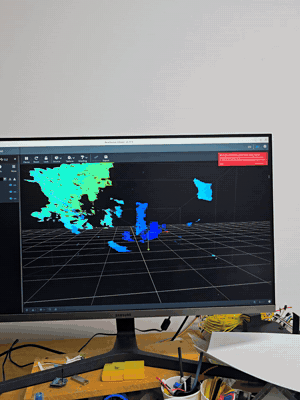
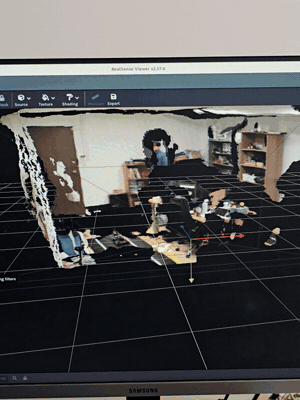

    

# 📷 Intel RealSense 뎁스 카메라 테스트

**스테레오 뎁스 카메라 기반 깊이 인식 · RGB-D 포인트 클라우드 확인**

> 📝 이 저장소는 **개인 연습 프로젝트 기록용**입니다. 별도 코드 없이 RealSense Viewer로 센서 동작을 확인한 결과를 정리했습니다.

---

자율주행 차량에 RealSense 스테레오 뎁스 카메라를 탑재하기 전에, 센서가 실제로 어떤 깊이 정보를 주는지 직접 확인하기 위해 진행한 테스트입니다. **뎁스 단독 스트림**과 **뎁스 + RGB(실사) 정합 포인트 클라우드**를 각각 3D 뷰로 띄워, 거리 인식 범위와 정합 품질을 눈으로 확인했습니다.

## 🎯 테스트 목표

- **뎁스 스트림 확인**: 스테레오 IR 기반으로 계산된 깊이 값을 3D 포인트 클라우드로 시각화해, 거리별 인식 범위와 노이즈·누락 영역을 확인
- **RGB-D 정합 확인**: RGB 컬러 영상을 뎁스 포인트에 텍스처로 입혀, 실제 장면(사람·책상·선반 등)과 깊이 정보가 올바르게 맞물리는지 확인
- **차량 적용 사전 검토**: 이후 [1/5 자율주행 프로젝트](https://github.com/GeonHoong/1-5-autonomous)에서 사용한 RealSense 기반 SLAM(RTAB-Map)·인지 모듈의 입력 품질을 미리 파악

## 🔍 확인 내용

<b>1. 뎁스(Depth) 스트림</b>

- 깊이 값을 컬러맵(가까울수록/멀수록 색상 변화)으로 표현한 3D 포인트 클라우드로 확인
- 카메라 앞 물체의 형상이 거리 정보만으로 입체적으로 복원되는 것을 확인
- 반사가 심하거나 텍스처가 없는 면, 측정 범위를 벗어난 영역은 포인트가 비어 보이는 등 스테레오 뎁스 특유의 한계도 함께 관찰

<b>2. 뎁스 + RGB(실사) 포인트 클라우드</b>

- RGB 영상을 뎁스 포인트에 정합해, 실제 색상이 입혀진 RGB-D 포인트 클라우드로 확인
- 실내에서 사람이 움직이는 장면을 3D 공간 상에서 실사 텍스처와 함께 확인
- 물체 경계 부분에서 뎁스-컬러 간 미세한 어긋남과 그림자(occlusion) 영역이 생기는 점을 확인

---

## 🎥 테스트 영상

  
  

뎁스 스트림 3D 포인트 클라우드 · 뎁스 + RGB(실사) 정합 포인트 클라우드

---

## 📎 연계 프로젝트

| 프로젝트 | 내용 |
|---|---|
| [1/5 자율주행 (aMAP Innovator Championship)](https://github.com/GeonHoong/1-5-autonomous) | RealSense 카메라를 차량 상단 마스트에 장착해 RTAB-Map SLAM 및 신호등 인식에 활용 |
| [YOLO 기반 Segmentation 학습](https://github.com/GeonHoong/yolo_training) | 카메라 영상 기반 차선·신호등·객체 인식 모델 학습 |
